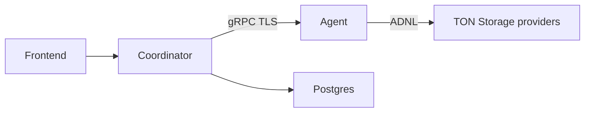

# mytonprovider-backend

**[Русская версия](README.ru.md)**

Backend for [mytonprovider.org](https://mytonprovider.org) — monitoring and health checks for TON Storage providers.

## Architecture

The coordinator serves the HTTP API for the frontend, keeps data in Postgres, runs background workers (provider lifecycle, telemetry, cleanup) and orchestrates checks via gRPC to agents. The agent lives in [mytonprovider-agent](https://github.com/mytonprovider/mytonprovider-agent), together with the protobuf contracts.



## Repository layout

```
├── cmd/                # coordinator entrypoint, dump-runchecks
├── internal/           # API, workers, clients, repositories
├── db/                 # init.sql + migrations
├── deploy/             # Docker Compose for VPS
└── Taskfile.yml        # dump, deploy tasks
```

## Development

**Prerequisites:** Go 1.26+, [Task](https://taskfile.dev).

### VS Code

Example `launch.json` entry:

```json
{
  "version": "0.2.0",
  "configurations": [
    {
      "name": "Coordinator",
      "type": "go",
      "request": "launch",
      "mode": "auto",
      "program": "${workspaceFolder}/cmd",
      "buildFlags": "-tags=debug"
    }
  ]
}
```

Set `env` to match `deploy/.env.example`.

### RunChecks dump

`dump-runchecks` builds a `RunChecks` request with the real coordinator logic and writes it to JSON. The agent replay tasks take this file — see [mytonprovider-agent](https://github.com/mytonprovider/mytonprovider-agent).

```bash
task dump:runchecks
```

Writes `tmp/runchecks-live.json` and `tmp/runchecks-live-meta.json` (geo by storage IP); `tmp/` is gitignored.

By default `dump-runchecks` uses **`--storage=memory`**: it runs `CollectNewProviders` and `CollectProvidersNewStorageContracts` against an in-process fake DB (no Postgres). You still need network access to TON (and a real `MASTER_ADDRESS` / `TON_CONFIG_URL` if defaults are not enough):

```bash
export MASTER_ADDRESS=<your-master-wallet>
task dump:runchecks
```

To read existing rows from Postgres instead (set `DB_*` the same as coordinator):

```bash
go run ./cmd/dump-runchecks --storage=postgres --limit 1 --out tmp/runchecks-live.json
```

`task dump:runchecks:with-storage-rates` also writes `tmp/runchecks-live-storage-rates.json` for `RunStorageRates` (pubkeys taken from the built RunChecks payload, same order). Manual equivalent:

```bash
go run ./cmd/dump-runchecks --limit 50 --out tmp/runchecks-live.json --also-dump-storage-rates
```

Optional flags: `--storage-rates-out`, `--rates-job-id`, `--rates-query-timeout-ms`, `--rates-total-ms`, `--rates-query-size` (see `go run ./cmd/dump-runchecks -help`).

## Docker deploy (VPS)

**Full order (coordinator → agents → TLS):** [deploy/README.md](deploy/README.md) (checklist at top), TLS details in [mytonprovider-agent](https://github.com/mytonprovider/mytonprovider-agent).

The image is published by the `publish` job in `CI` after checks on every push to `master`: `ghcr.io/mytonprovider/mytonprovider-backend:<tag>`, the tag is the first 7 characters of the commit. Manual `task image:build:push` stays as a fallback.

```bash
# VPS
task hub:init && nano deploy/.env.hub && task hub:up
```

**Quick start** (build on VPS, dev/debugging):

```bash
task deploy:init
nano deploy/.env
task deploy:up
```

**Frontend-only deploy** (after coordinator is already running):

```bash
# Required:
# - DOMAIN: domain or IP where frontend will be served
# - PUBLIC_ORIGIN: origin used by frontend API calls
# Optional:
# - INSTALL_SSL=true (domain only), COORDINATOR_PORT=8080
# By public IP (no SSL):
DOMAIN=203.0.113.1 PUBLIC_ORIGIN=http://203.0.113.1 INSTALL_SSL=false task deploy:frontend
# By domain:
DOMAIN=mytonprovider.org PUBLIC_ORIGIN=https://mytonprovider.org INSTALL_SSL=true task deploy:frontend
```

This task runs `deploy/deploy_frontend.sh`: it installs dependencies, configures Nginx, builds frontend static files, and sets proxy routes (`/api`, `/health`, `/metrics`) to coordinator.

Quick smoke checks after frontend deploy:

```bash
curl -fsS "http://127.0.0.1:8080/health"
curl -fsS "http://127.0.0.1:8080/api/v1/providers/filters"
curl -fsS "http://127.0.0.1/"
```

## Coordinator API and workers

REST API (Fiber): telemetry, provider listing/filters, metrics.

Background workers:

- **Providers Master** — provider lifecycle, health checks, gRPC to agents
- **Telemetry Worker** — incoming provider telemetry
- **Cleaner Worker** — database retention

## License

Apache-2.0 — see [LICENSE](LICENSE).

This project was created by order of a TON Foundation community member.
