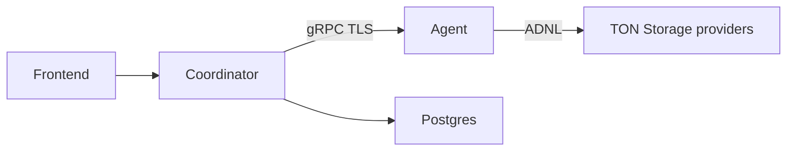

# mytonprovider-backend

**[English version](README.md)**

Backend для [mytonprovider.org](https://mytonprovider.org) — мониторинг и проверки здоровья провайдеров TON Storage.

## Архитектура

Coordinator отдаёт HTTP API для фронтенда, хранит данные в Postgres, ведёт фоновые воркеры (жизненный цикл провайдеров, телеметрия, очистка) и вызывает проверки по gRPC у агентов. Агент вместе с protobuf-контрактами лежит в [mytonprovider-agent](https://github.com/mytonprovider/mytonprovider-agent).



## Структура репозитория

```
├── cmd/                # точка входа coordinator, dump-runchecks
├── internal/           # API, воркеры, клиенты, репозитории
├── db/                 # init.sql и миграции
├── deploy/             # Docker Compose для VPS
└── Taskfile.yml        # дамп, деплой
```

## Разработка

**Нужно:** Go 1.26+, [Task](https://taskfile.dev).

### VS Code

Пример `launch.json`:

```json
{
  "version": "0.2.0",
  "configurations": [
    {
      "name": "Coordinator",
      "type": "go",
      "request": "launch",
      "mode": "auto",
      "program": "${workspaceFolder}/cmd",
      "buildFlags": "-tags=debug"
    }
  ]
}
```

Переменные `env` задайте по `deploy/.env.example`.

### Дамп RunChecks

`dump-runchecks` собирает запрос `RunChecks` настоящей логикой coordinator и пишет его в JSON. Этот файл берут задачи replay агента — см. [mytonprovider-agent](https://github.com/mytonprovider/mytonprovider-agent).

```bash
task dump:runchecks
```

Пишет `tmp/runchecks-live.json` и `tmp/runchecks-live-meta.json` (гео по storage IP); `tmp/` в gitignore.

По умолчанию `dump-runchecks` с **`--storage=memory`**: in-process fake DB (без Postgres). Нужна сеть до TON (и `MASTER_ADDRESS` / `TON_CONFIG_URL`, если дефолтов мало):

```bash
export MASTER_ADDRESS=<your-master-wallet>
task dump:runchecks
```

Чтение из Postgres (`DB_*` как у coordinator):

```bash
go run ./cmd/dump-runchecks --storage=postgres --limit 1 --out tmp/runchecks-live.json
```

`task dump:runchecks:with-storage-rates` дополнительно пишет `tmp/runchecks-live-storage-rates.json` для `RunStorageRates` (pubkeys из RunChecks payload, тот же порядок). Вручную:

```bash
go run ./cmd/dump-runchecks --limit 50 --out tmp/runchecks-live.json --also-dump-storage-rates
```

Флаги: `--storage-rates-out`, `--rates-job-id`, `--rates-query-timeout-ms`, `--rates-total-ms`, `--rates-query-size` (см. `go run ./cmd/dump-runchecks -help`).

## Docker-деплой (VPS)

**Полный порядок (coordinator → агенты → TLS):** [deploy/README.ru.md](deploy/README.ru.md) (чеклист в начале), TLS — [mytonprovider-agent](https://github.com/mytonprovider/mytonprovider-agent).

Образ публикует задание `publish` в `CI` после проверок при каждом push в `master`: `ghcr.io/mytonprovider/mytonprovider-backend:<tag>`, тег — первые 7 символов коммита. Ручной `task image:build:push` остаётся запасным путём.

```bash
# VPS
task hub:init && nano deploy/.env.hub && task hub:up
```

**Быстрый старт** (сборка на VPS, dev/отладка):

```bash
task deploy:init
nano deploy/.env
task deploy:up
```

**Отдельный деплой фронтенда** (когда coordinator уже запущен):

```bash
# Обязательно:
# - DOMAIN: домен или IP, где будет отдаваться фронт
# - PUBLIC_ORIGIN: origin для API-запросов из фронта
# Опционально:
# - INSTALL_SSL=true (только для домена), COORDINATOR_PORT=8080
# По IP (без SSL):
DOMAIN=203.0.113.1 PUBLIC_ORIGIN=http://203.0.113.1 INSTALL_SSL=false task deploy:frontend
# По домену:
DOMAIN=mytonprovider.org PUBLIC_ORIGIN=https://mytonprovider.org INSTALL_SSL=true task deploy:frontend
```

Эта task-команда запускает `deploy/deploy_frontend.sh`: ставит зависимости, настраивает Nginx, собирает статику фронта и проксирует (`/api`, `/health`, `/metrics`) на coordinator.

Быстрые проверки после деплоя фронта:

```bash
curl -fsS "http://127.0.0.1:8080/health"
curl -fsS "http://127.0.0.1:8080/api/v1/providers/filters"
curl -fsS "http://127.0.0.1/"
```

## API и воркеры coordinator

REST (Fiber): телеметрия, список/фильтры провайдеров, метрики.

Фоновые воркеры:

- **Providers Master** — жизненный цикл провайдеров, health checks, gRPC к агентам
- **Telemetry Worker** — телеметрия от провайдеров
- **Cleaner Worker** — очистка устаревших данных в БД

## Лицензия

Apache-2.0 — см. [LICENSE](LICENSE).

Проект создан по заказу участника сообщества TON Foundation.
